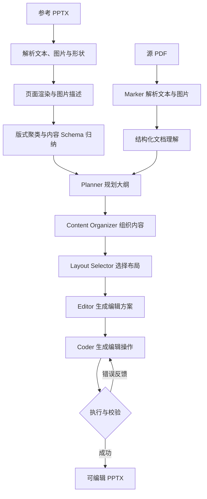

<div align="center">

# PPTAgent

### 从文档到演示文稿，让内容组织与版式设计协同完成

基于大语言模型与视觉模型的 PowerPoint 自动生成项目。<br>
输入 PDF 和参考 PPTX，完成文档理解、版式归纳、内容规划与幻灯片编辑，输出可继续修改的 PPTX。


[](LICENSE)

[项目亮点](#项目亮点) · [工作原理](#工作原理) · [快速开始](#快速开始) · [项目结构](#项目结构) · [常见问题](#常见问题)

</div>

## 项目简介

PPTAgent 将演示文稿生成拆分为两个阶段：先学习参考 PPT 的版式与元素结构，再将文档内容组织成适合展示的页面。生成过程中，不同 Agent 分别负责大纲规划、内容组织、布局选择和编辑操作，通过结构校验与错误反馈进行修正。

适用于论文汇报、技术分享、课程展示和报告初稿生成等场景。输出保留 PPTX 的可编辑形式，便于在 PowerPoint 等软件中继续调整文字、图片和排版。

> 来源说明：本项目代码源自 [ICIP-CAS/PPTAgent](https://github.com/icip-cas/PPTAgent)。本文档根据当前目录中的实现整理，功能与启动方式以本地代码为准。原项目版权与 MIT 许可声明见 [LICENSE](LICENSE)。

## 项目亮点

| 能力 | 实现方式 |
| --- | --- |
| 文档理解 | 使用 Marker 将 PDF 转换为 Markdown、图片及元数据，结合语言模型与视觉模型构建结构化文档 |
| 参考版式学习 | 解析参考 PPT 的文本、图片和形状，结合图像特征聚类与模型分析归纳布局及内容 Schema |
| 多角色协作 | Planner、Content Organizer、Layout Selector、Editor、Coder 分工完成规划与编辑 |
| 可编辑文件输出 | 将模型生成的编辑指令转换为幻灯片操作，保存为 `.pptx` 文件 |
| 校验与反馈修正 | 对模型输出和编辑操作进行校验，根据异常反馈重试 |
| 浏览器交互 | Vue 3 上传界面、FastAPI 后端、WebSocket 进度更新与结果下载 |
| 中间结果复用 | 按上传文件的 MD5 存储解析结果，复用文档解析、图片描述和版式分析缓存 |
| 质量评估模块 | 提供内容、视觉与逻辑维度的模型评估代码，见 `pptagent/ppteval.py` |

## 工作原理



角色提示词位于 [`pptagent/roles/`](pptagent/roles)，可通过修改 YAML 配置调整规划、内容组织与编辑行为。核心库同时提供同步和异步实现，Web 后端使用异步版本。

## 技术栈

| 层级 | 主要技术 |
| --- | --- |
| 前端 | Vue 3、Vue Router、Axios、Vue CLI |
| 后端 | Python、FastAPI、Uvicorn、WebSocket |
| 模型调用与角色编排 | OpenAI 兼容客户端、Jinja2、YAML、Tenacity |
| 文档与幻灯片处理 | Marker PDF、定制版 python-pptx、LibreOffice、pdf2image |
| 视觉特征与推理 | PyTorch、Transformers、ViT |

## 快速开始

### 1. 准备运行环境

- **Python ≥ 3.11**：项目声明的最低版本；可先使用 Python 3.11 创建独立环境。
- **Node.js 与 npm**：用于安装和启动 Vue 前端。
- **Git**：Python 依赖包含通过 Git 安装的定制版 `python-pptx`。
- **LibreOffice 与 Poppler**：用于将 PPTX 转为 PDF，再渲染为图片；`soffice`、`pdftoppm` 和 `pdfinfo` 需要在 `PATH` 中。
- **Chrome / Chromium**：部分 HTML、Markdown 表格转图片路径使用 `html2image`。
- **模型服务**：需要聊天、图像理解与文本向量能力，配置方式见下文。

Ubuntu / Debian 系统依赖示例：

```bash
sudo apt-get update
sudo apt-get install -y git libreoffice poppler-utils
```

Chrome / Chromium 需按操作系统安装。macOS 安装 LibreOffice 后，如找不到 `soffice`，可将其程序目录加入当前终端：

```bash
export PATH="/Applications/LibreOffice.app/Contents/MacOS:$PATH"
```

代码会在 CUDA 可用时选择 GPU，否则选择 CPU。PDF 解析与视觉模型包含本地推理，运行速度和兼容性取决于硬件；首次使用还需要下载相应模型权重。

### 2. 安装项目依赖

在本项目根目录执行：

```bash
python3.11 -m venv .venv
source .venv/bin/activate
python -m pip install --upgrade pip
python -m pip install -e .
npm install --prefix pptagent_ui
```

项目直接使用 `torch` 和 `torchvision`。如果依赖安装后仍缺少这两个模块，请根据运行设备安装匹配版本的 PyTorch 与 torchvision。具体 Python 依赖见 [`pyproject.toml`](pyproject.toml) 和 [`requirements.txt`](requirements.txt)。

### 3. 配置模型

在启动后端的终端中设置环境变量：

```bash
export OPENAI_API_KEY="your-api-key"
export LANGUAGE_MODEL="gpt-4.1"
export VISION_MODEL="gpt-4.1"
export TEXT_MODEL="text-embedding-3-small"

# 使用兼容服务时设置；填写服务提供的 API 根地址
# export API_BASE="https://your-provider.example/v1"
```

| 环境变量 | 用途 | 当前代码默认值 |
| --- | --- | --- |
| `OPENAI_API_KEY` | 模型服务访问密钥 | 由客户端读取，需自行设置 |
| `API_BASE` | 自定义模型服务地址 | 未设置，由客户端使用默认地址 |
| `LANGUAGE_MODEL` | 文档理解、大纲规划和编辑 | `gpt-4.1` |
| `VISION_MODEL` | 图片描述与视觉分析 | `gpt-4.1` |
| `TEXT_MODEL` | 文本向量与历史检索 | `text-embedding-3-small` |
| `LOG_LEVEL` | 日志级别，使用数值 | `20`（INFO） |

以上模型名称来自当前代码的默认配置，实际可用性以所接入服务为准。视觉模型需支持图像输入，向量模型需支持 embeddings；当前 `ModelManager` 为三类模型共用 `API_BASE`。程序不会自动加载 `.env` 文件，请通过终端导出或启动工具注入环境变量。

### 4. 启动后端

在已激活 Python 环境、已配置模型变量的终端中，从项目根目录执行：

```bash
cd pptagent_ui
python backend.py
```

后端默认监听 `9297` 端口，启动时会检查模型服务连接。接口文档可在 [http://localhost:9297/docs](http://localhost:9297/docs) 查看。

> 请在 `pptagent_ui/` 目录启动后端。当前实现依据工作目录计算 `runs/` 路径，并通过相对路径引入项目模块。

### 5. 启动前端并生成 PPT

另开终端，从项目根目录执行：

```bash
cd pptagent_ui
npm run serve
```

访问 [http://localhost:8088](http://localhost:8088)：

1. 上传用于学习版式的 **PPTX** 文件。
2. 上传提供内容的 **PDF** 文件。
3. 选择目标页数，当前界面支持 **3–14 页**，默认 **6 页**。
4. 点击 **Next**，保持生成页面连接，等待进度更新。
5. 生成完成后点击 **Download PPTX** 下载结果。

前端开发服务器已将 `/api` 与 `/wsapi` 代理至本地后端。代理配置见 [`pptagent_ui/vue.config.js`](pptagent_ui/vue.config.js)。

## 接口与生成结果

| 方法 | 路径 | 作用 |
| --- | --- | --- |
| `POST` | `/api/upload` | 通过 multipart 表单提交 `pptxFile`、`pdfFile` 和 `numberOfPages`，返回 `task_id` |
| `WebSocket` | `/wsapi/{task_id}` | 接收 `progress` 与 `status` 字段，展示阶段进度 |
| `GET` | `/api/download?task_id=...` | 下载已完成任务的 PPTX |
| `POST` | `/api/feedback` | 提交 `task_id` 和 `feedback`；需要预先创建 `runs/feedback/` 目录 |

直接调用上传接口后，需及时建立 WebSocket 连接；当前后端约等待 2 秒，未连接则取消该次生成。建议首次使用通过前端完成整个流程。

任务文件保存在项目根目录的 `runs/` 下：

```text
runs/
├── pptx/<文件 MD5>/          # 参考 PPT、页面图片、版式与图片分析缓存
├── pdf/<文件 MD5>/           # 原始 PDF、Markdown、图片与结构化文档
└── <日期>/<任务 UUID>/
    ├── task.json            # 任务配置
    └── final.pptx           # 最终演示文稿
```

接口返回的任务标识使用 `|` 替换路径中的 `/`，调用后续接口时可直接使用返回值。

## 项目结构

```text
PPTAgent/
├── pptagent/                # Python 核心库
│   ├── document/            # 文档结构、内容提取与图文组织
│   ├── presentation/        # 幻灯片、布局和形状抽象
│   ├── roles/               # Agent 角色及提示词配置
│   ├── prompts/             # 分类、分析与评估提示词
│   ├── agent.py             # 角色调用、对话历史和重试
│   ├── apis.py              # 幻灯片编辑 API 与操作执行器
│   ├── induct.py            # 版式归纳与内容 Schema 提取
│   ├── pptgen.py            # 大纲规划与 PPT 生成主流程
│   ├── model_utils.py       # 模型管理、PDF 解析与图像特征
│   ├── llms.py              # 同步 / 异步模型客户端封装
│   ├── multimodal.py        # 图片描述与多模态辅助处理
│   └── ppteval.py           # 演示文稿质量评估
├── pptagent_ui/             # Vue 前端与 FastAPI 服务入口
│   ├── src/components/      # 文件上传与生成进度页面
│   ├── backend.py           # 任务管理、生成调度与文件下载
│   └── vue.config.js        # 前端端口与 HTTP / WebSocket 代理
├── pptx/                    # 随源码保留的 python-pptx 代码
├── docker/                  # 容器环境与启动脚本
├── pyproject.toml           # Python 包元数据与依赖
└── LICENSE                  # MIT 许可证
```

## 常见问题

**不上传参考 PPTX 能否生成？**

接口会使用 `default_template` 标识，但当前目录未附带对应模板。首次运行请同时上传 PPTX 与 PDF；如需默认模板，须自行准备 `runs/pptx/default_template/source.pptx`。

**为什么最终页数与选择值不同？**

系统可能增加封面、目录、章节过渡页或结束页；同时，后端设置 `error_exit=False`，单页失败时可能跳过该页。页数目前作为规划参数，默认未启用 `force_pages`，不保证精确匹配。

**提示 `Model connection test failed` 怎么办？**

检查后端终端中的密钥、`API_BASE` 和网络配置。当前连接检查调用模型列表接口；通过检查后，还需确保所配置模型分别支持聊天、图像输入及向量生成。

**PPT 转图片失败或提示找不到 `soffice`？**

确认 LibreOffice 与 Poppler 已安装且相关命令可在后端终端找到。中文或特殊字体缺失也会影响渲染效果，应安装参考 PPT 使用的字体。

**Dockerfile 可以直接用于构建当前代码吗？**

现有 [`docker/Dockerfile`](docker/Dockerfile) 包含从上游仓库执行 `git clone` 的步骤，默认不会打包本地修改。若要容器化当前版本，应先调整源码复制与安装步骤；上述快速开始采用本地源码启动。

## 当前范围

- Web 主流程使用 **PDF 内容 + PPTX 参考版式**。后端虽保留 `topic` 参数，当前流程仍读取 PDF 文件，未实现仅输入主题即可生成的完整链路。
- 异步实现用于模型调用与任务调度；PDF 解析等步骤仍包含同步计算，当前服务未配置独立任务队列或持久化任务状态。
- `ppteval.py` 提供评估模块，当前 Web 生成流程未自动调用该模块。
- 生成质量取决于源文档、参考版式与模型输出，交付前应检查内容准确性、页面溢出和图文匹配。

## 致谢与许可

感谢 [PPTAgent 原项目](https://github.com/icip-cas/PPTAgent) 及其依赖的开源工具。本项目采用 [MIT License](LICENSE)，使用或分发时请保留原有版权与许可声明。
# PPTAgent
